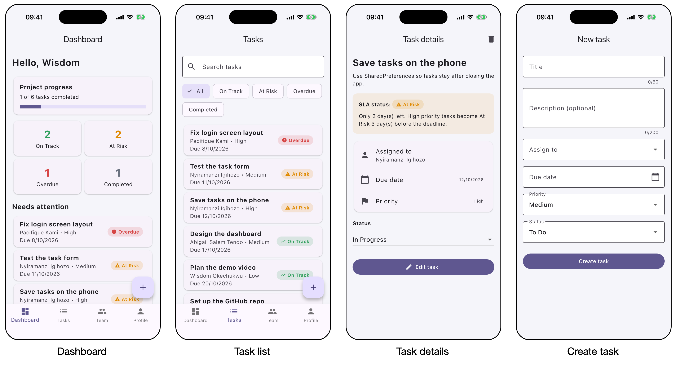

# OnTrack

A Flutter mobile app for a small software team to manage project tasks and see which ones are at risk of missing their deadline.

Each task has an assignee, a priority, a due date and a status. From those, the app shows an SLA status: On Track, At Risk, Overdue or Completed.



Group 18, Formative 1 group project.

## What you can do

- Sign in by tapping your name. There is no password.
- See the project progress, the count of tasks in each SLA status, and the tasks that need attention.
- Create, edit and delete tasks, and move a task from To Do to In Progress to Done.
- Search tasks by title and filter them by SLA status.
- Add, edit and remove team members. Removing a member unassigns their tasks.
- Close the app and open it again. The tasks, the members and the signed-in member are still there.

The app has eight screens: Sign in, Dashboard, Task list, Task details, Create/Edit task, Team, Member form and Profile.

## SLA rules

Checked in order, the first match wins:

1. Completed: the status is Done.
2. Overdue: the due date has passed.
3. At Risk: the due date is close. High priority: 3 days or less. Medium: 2 days. Low: 1 day.
4. On Track: everything else.

The code is in `lib/logic/sla.dart`.

## Team

| Member | Branches | Part of the app |
|--------|----------|-----------------|
| Wisdom Ikechukwu Okechukwu | `wisdom`, `wisdom-count-sla`, `wisdom-review-fixes`, `wisdom-code-quality`, `wisdom-readme-filter-test` | SLA rules, app start, bottom navigation, dashboard, app tests, review fixes |
| Pacifique Kami | `pacifique`, `pacifique-sort-tasks` | Task list, task details, task form, task card |
| Nyiramanzi Igihozo | `nyiramanzi`, `nyiramanzi-more-tests` | Task and Member models, saving and loading, storage tests |
| Abigail Salem Tendo | `abigail`, `abigail-sla-icons` | Colours, SLA badge, sign in, member form, team, profile |

The file each member owns is listed in `docs/TASKS.md`. Every branch reached `main` through a pull request.

## Project structure

```
lib/
  main.dart                    loads saved data, starts the app
  constants.dart               colours, dropdown choices, date format
  models/task.dart             the Task class
  models/member.dart           the Member class
  data/app_data.dart           all data, saved with SharedPreferences
  logic/sla.dart               the SLA rules
  widgets/confirm_dialog.dart  the "are you sure?" dialog
  widgets/sla_badge.dart       coloured SLA label, its colour and icon
  widgets/task_card.dart       one task in a list
  screens/sign_in_screen.dart
  screens/home_screen.dart     bottom navigation bar
  screens/dashboard_screen.dart
  screens/task_list_screen.dart
  screens/task_details_screen.dart
  screens/task_form_screen.dart
  screens/team_screen.dart
  screens/member_form_screen.dart
  screens/profile_screen.dart
test/                          tests for the SLA rules, saving, and the main flows
docs/                          spec and task split
```

## How it works

- State: every screen is a `StatefulWidget` and calls `setState()` when its data changes. After coming back from another screen it calls `setState(() {})` to show the latest data.
- Storage: `AppData` keeps the tasks and members in lists and saves them as JSON text with SharedPreferences after every change.
- Navigation: `Navigator.push` to open a screen, `Navigator.pop` to go back, and a `BottomNavigationBar` for the four main tabs.
- Validation: a `Form` with `TextFormField` validators. Pressing Save with mistakes shows the error under each field.

## Run

```
flutter pub get
flutter run
```

Run it on an emulator or a phone, not in a browser. We ran it on an iPhone simulator and on an Android 16 emulator.

## Test

```
flutter analyze
flutter test
```

`flutter test` runs 33 tests. They cover the SLA rules, saving and loading, the forms, the task list filters and the main flows.

## AI assistance

This project was built with AI assistance. We used Claude by Anthropic to help write the code and the tests and to review them. The spec in `docs/specs/sla-task-tracker.md` and its acceptance tests came first. The group report has the full AI usage declaration.
